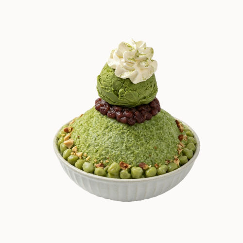

# Matcha Bingsu

{ width="320" }

Make it look like this photo.

- **Purpose:** Make the Matcha Bingsu the same way every time.
- **Who does it:** Dessert station staff
- **When:** Every Matcha Bingsu order
- **Time needed:** TODO(owner)
- **Equipment and supplies:** bingsu machine, measuring jug, shot measure, cup or bowl, ice cream scoop, whipped cream dispenser
- **Last reviewed:** 2026-11-06

## Ingredients

- Milk mix: **matcha base** + sugar syrup + milk. Cup: 60 ml syrup + 300 ml milk. Bowl: 90 ml syrup + 500 ml milk. See [Sizes](index.md#sizes).
- Red bean: **as in the photo** (more for a bowl)
- Mochi: **as in the photo** (more for a bowl)
- Almond flakes: **as in the photo** (more for a bowl)
- Condensed milk: drizzle
- Matcha powder: to decorate
- Matcha ice cream: **1 scoop**
- Whipped cream: spray on top of the ice cream

!!! warning "⚠️ Warning: allergens"
    - Milk, condensed milk, whipped cream and ice cream: **milk**. TODO(owner): ice cream brand, to check other allergens.
    - Matcha powder: check the label.
    - Red bean: check the label.
    - Mochi: check the label (some contain wheat).
    - Almond flakes: **almond (tree nut)**.
    - If a customer asks about allergens and you are not sure, **do not guess**. Ask the shift lead.

## Steps

1. Make the milk mix with **matcha base**. Follow [Make the milk mix](index.md#make-the-milk-mix).
2. Make the shaved ice. Follow [Make the shaved ice](index.md#make-the-shaved-ice).
3. Add the toppings, **as in the photo**. Use more toppings for a bowl.
4. Put **1 scoop** of matcha ice cream on top.
5. Spray **whipped cream** on top of the ice cream.
6. Decorate with powder or sauce, as in the photo.
7. **Uber Eats?** Pack it in a round container and put the ice cream separately. See [Uber Eats](index.md#uber-eats).
8. Check that it looks like the photo, then serve.

## Before serving

- [ ] Right size: cup or bowl
- [ ] Shaved ice is fluffy and fills the cup or bowl
- [ ] All toppings are on, as in the photo
- [ ] 1 scoop of matcha ice cream and whipped cream on top
