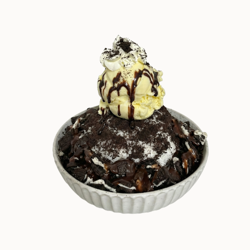

# Oreo Bingsu

{ .lsc-photo width="320" }

**Purpose:** Make the Oreo Bingsu the same way every time. 
**Who does it:** Dessert station staff 
**When:** Every Oreo Bingsu order 
**Time needed:** TODO(owner) 
**Equipment and supplies:** bingsu machine, measuring jug, shot measure, cup or bowl, ice cream scoop, whipped cream dispenser 
**Last reviewed:** 2026-11-06

## Ingredients

- Milk mix: **plain milk (no flavour base)** + sugar syrup + milk. Cup: 60 ml syrup + 300 ml milk. Bowl: 90 ml syrup + 500 ml milk. See [Sizes](index.md#sizes).
- Oreo: crushed and broken pieces
- Chocolate powder: to decorate
- Chocolate sauce: drizzle (as in the photo)
- Vanilla ice cream: **1 scoop**
- Whipped cream: spray on top of the ice cream

!!! danger "⚠️ Warning: allergens"
    - Milk, condensed milk, whipped cream and ice cream: **milk**. TODO(owner): ice cream brand, to check other allergens.
    - Oreo: **wheat (gluten), soy**. Check the pack for milk.
    - Chocolate powder: check the label (may contain milk, soy).
    - Chocolate sauce: may contain **milk, soy**. Check the bottle label.
    - If a customer asks about allergens and you are not sure, **do not guess**. Ask the shift lead.

## Steps

1. Make the milk mix with **plain milk (no flavour base)**. Follow [Make the milk mix](index.md#make-the-milk-mix).
2. Make the shaved ice. Follow [Make the shaved ice](index.md#make-the-shaved-ice).
3. Add the toppings, **as in the photo**. Use more toppings for a bowl.
4. Put **1 scoop** of vanilla ice cream on top.
5. Spray **whipped cream** on top of the ice cream.
6. Decorate with powder or sauce, as in the photo.
7. **Takeaway or Uber Eats?** Make the bowl size, pack it in a round container and put the ice cream separately. See [Takeaway and Uber Eats](index.md#takeaway-and-uber-eats).
8. Check that it looks like the photo, then serve.

## Before serving

- [ ] Right size: cup or bowl
- [ ] Shaved ice is fluffy and fills the cup or bowl
- [ ] All toppings are on, as in the photo
- [ ] 1 scoop of vanilla ice cream and whipped cream on top
