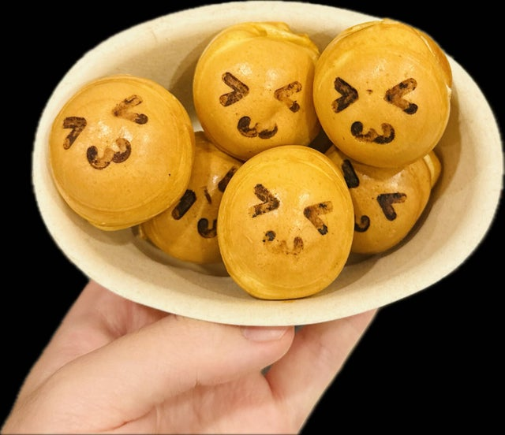
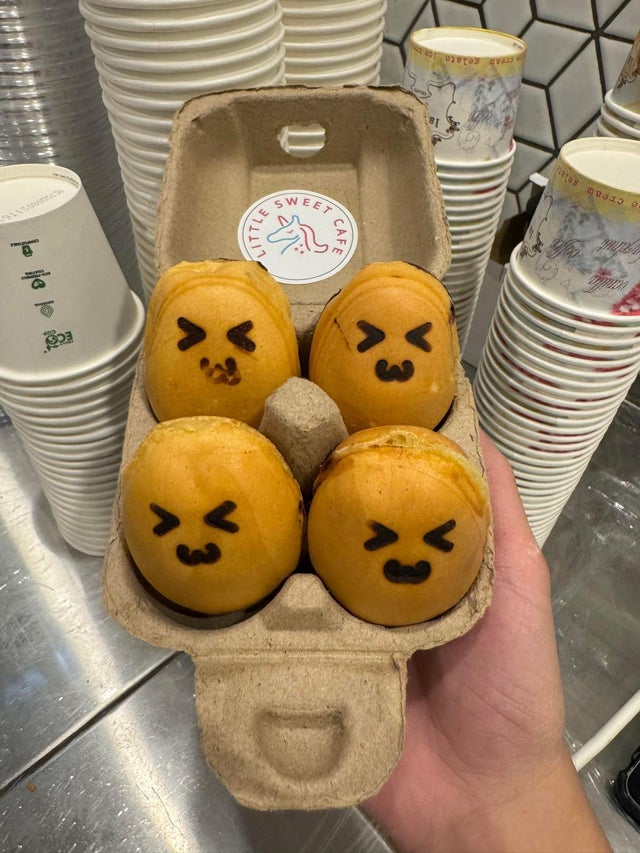

# Cutie Puff and Egg Yaki

Cutie Puffs and Egg Yaki are made the same way: batter, then filling, then batter.

{ .lsc-photo width="240" }
{ .lsc-photo width="200" }

**Purpose:** Make Cutie Puffs and Egg Yaki the same way every time. 
**Who does it:** Dessert station staff 
**When:** Every Cutie Puff or Egg Yaki order 
**Time needed:** 4 min in the machine, plus serving 
**Equipment and supplies:** Cutie Puff / Egg Yaki machine, batter, fillings, paper bowl (Cutie Puff), egg carton (Egg Yaki) 
**Last reviewed:** 2026-11-06

The batter is made in advance. Its recipe is not in these docs.

TODO(owner): machine brand and model, temperature, and how the faces are made.

## Serves

- **Cutie Puff:** **6** or **10** pieces, as ordered. Serve in a paper bowl. TODO(owner): which filling?
- **Egg Yaki:** **4** pieces in an egg carton. The customer chooses **2 fillings** from: Taro, Chocolate, Custard, Red Bean, Oreo. TODO(owner): is it 2 pieces of each filling?

!!! danger "⚠️ Warning: allergens"
    - Batter: TODO(owner): confirm. Treat it as containing **egg, milk and wheat (gluten)** until confirmed.
    - Fillings: check each label. Oreo: **wheat (gluten), soy**. Custard and chocolate: usually **milk** (custard often has **egg**).
    - If a customer asks about allergens and you are not sure, **do not guess**. Ask the shift lead.

## Steps

1. Check the order: how many Cutie Puffs (6 or 10), or which 2 Egg Yaki fillings.
2. Put **a little batter** in each mould.
3. Add the **filling** on top of the batter.
4. Cover the filling with **more batter**.
5. Close the machine and cook for **4 min**.
6. Take the pieces out.
7. Serve: Cutie Puffs in a paper bowl; Egg Yaki in an egg carton, as in the photo.

## Before serving

- [ ] Right number of pieces (Cutie Puff: 6 or 10; Egg Yaki: 4)
- [ ] Right fillings for the order
- [ ] Cooked golden, as in the photo
