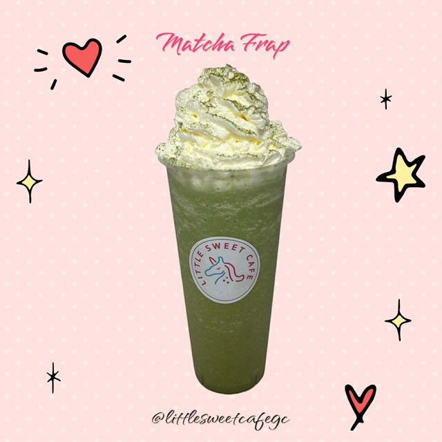

# Frappe

All frappes are made the same way. Only the flavour changes.

{ .lsc-photo width="240" }

**Purpose:** Make every frappe the same way. 
**Who does it:** Drinks station staff 
**When:** Every frappe order 
**Time needed:** TODO(owner) 
**Equipment and supplies:** blender, shot measure, ice scoop, measuring jug, cup, whipped cream dispenser 
**Last reviewed:** 2026-11-06

## Flavours

- **Fruit frappes (Mango, Grape, Strawberry):** 60 ml of that fruit sauce
- **Matcha Frappe:** 6 g matcha powder, dissolved in hot water
- **Oreo Frappe:** 1 tbsp cocoa powder, dissolved in hot water. Crushed Oreo on top.

TODO(owner): how much hot water to dissolve the matcha or cocoa (ml).

The Berrynana frappe is no longer sold.

## Ingredients (1 cup)

- Flavour: see above
- Ice: **2 scoops**
- Coffee-mate: **1 spoon**
- Sugar syrup: **2 shots** (60 ml)
- Milk: **200 ml**
- Whipped cream: on top
- Sprinkles: on top. The Matcha Frappe photo shows matcha powder on the cream instead. TODO(owner): confirm.
- Oreo Frappe only: crushed Oreo on top. TODO(owner): how much.

!!! danger "⚠️ Warning: allergens"
    - Milk, Coffee-mate and whipped cream: **milk**. Check the Coffee-mate label.
    - Fruit sauces, matcha, cocoa and sprinkles: check each label.
    - Oreo: **wheat (gluten), soy**. Check the pack for milk.
    - If a customer asks about allergens and you are not sure, **do not guess**. Ask the shift lead.

## Steps

1. **Matcha or Oreo?** Dissolve the powder in hot water first: **6 g matcha** or **1 tbsp cocoa**.
2. Put the flavour in the blender: **60 ml** fruit sauce, or the dissolved powder.
3. Add **2 scoops** of ice.
4. Add **1 spoon** of Coffee-mate.
5. Add **2 shots** (60 ml) of sugar syrup.
6. Add **200 ml** milk.
7. Blend until smooth. TODO(owner): blender setting or time.
8. Pour into the cup.
9. Spray **whipped cream** on top.
10. Add **sprinkles** on the cream. Oreo Frappe: add **crushed Oreo** instead.
11. Close the cup. See [Milk Tea: Finish and seal](../milk-tea/index.md#finish-and-seal).

## Before serving

- [ ] Right flavour for the order
- [ ] Smooth, with no ice lumps
- [ ] Whipped cream and sprinkles (or crushed Oreo) on top
