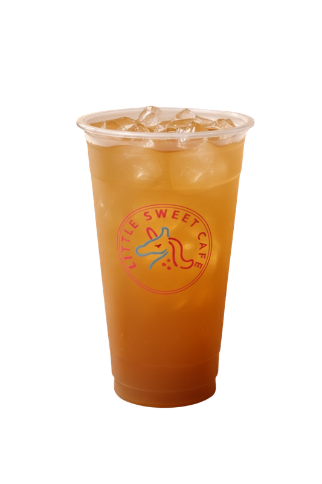

# Iced Tea

All 6 iced teas are made the same way. Only the fruit sauce changes.

{ width="240" }

- **Purpose:** Make every iced tea the same way.
- **Who does it:** Drinks station staff
- **When:** Every iced tea order
- **Time needed:** TODO(owner)
- **Equipment and supplies:** shaker, shot measure or fruit sauce pump, ice scoop, cup, sealer
- **Last reviewed:** 2026-11-06

## Flavours

Use the fruit sauce that matches the order:

- Grape
- Passionfruit
- Lychee
- Peach
- Grapefruit
- Mango

## Ingredients (1 cup)

- Fruit sauce: **60 ml** (6 pumps or 2 shots)
- Sugar syrup: **15 ml** (half a shot)
- Ice: **1 scoop**
- Tea: fill to the top. TODO(owner): which tea, and is it made in advance?

!!! warning "⚠️ Warning: allergens"
    - Fruit sauces: check each bottle label.
    - If a customer asks about allergens and you are not sure, **do not guess**. Ask the shift lead.

## Steps

1. Add **60 ml** of the fruit sauce to the shaker (6 pumps or 2 shots).
2. Add **15 ml** sugar syrup (half a shot).
3. Add **1 scoop** of ice.
4. Fill up with tea.
5. Shake well.
6. Pour everything into the cup.
7. Add any **drink toppings** the customer ordered. See [Milk Tea: Drink toppings](../milk-tea/index.md#drink-toppings).
8. Close the cup. See [Milk Tea: Finish and seal](../milk-tea/index.md#finish-and-seal).

## Before serving

- [ ] Right fruit flavour for the order
- [ ] Right toppings for the order
- [ ] Cup is full and closed
