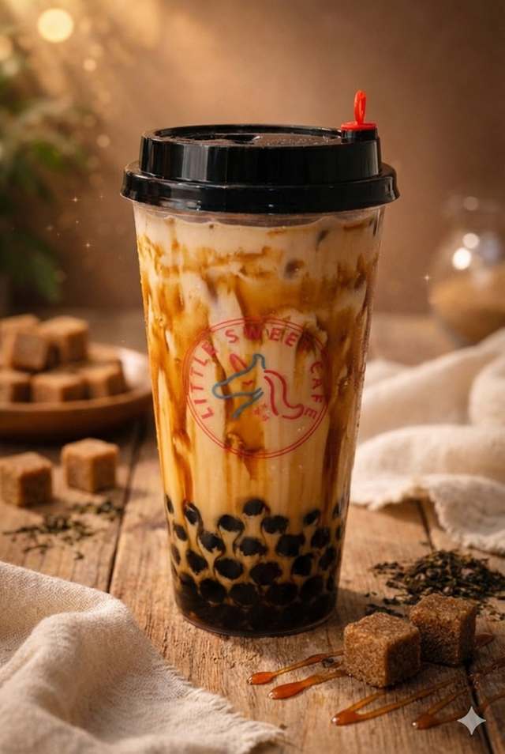

# Brown Sugar Bubble Tea

{ width="320" }

Make it look like this photo.

- **Purpose:** Make the Brown Sugar Bubble Tea the same way every time.
- **Who does it:** Drinks station staff
- **When:** Every Brown Sugar Bubble Tea order
- **Time needed:** TODO(owner)
- **Equipment and supplies:** cup, pearl scoop, ice scoop, shaker (powder drinks), sealer
- **Last reviewed:** 2026-11-06

## Ingredients (1 cup)

- Pearls: **1.5 scoops**
- Brown sugar syrup: **50 ml**
- Ice: **1 scoop**
- Fresh milk: to almost full

!!! warning "⚠️ Warning: allergens"
    - Fresh milk: **milk**.
    - Pearls: check the label.
    - Brown sugar syrup: check the label.
    - If a customer asks about allergens and you are not sure, **do not guess**. Ask the shift lead.

## Steps

1. Add **1.5 scoops** of pearls to the cup.
2. Add **50 ml** brown sugar syrup.
3. Add **1 scoop** of ice.
4. Pour **fresh milk** until the cup is **almost full**.
5. Add any **drink toppings** the customer ordered. See [Drink toppings](index.md#drink-toppings).
6. Close the cup (seal or lid). See [Finish and seal](index.md#finish-and-seal).

TODO(owner): order of pearls, syrup and ice, if it matters (for example, syrup coated around the cup).

## Before serving

- [ ] Right drink and right toppings for the order
- [ ] Cup is filled to the right level
- [ ] Cup is closed (seal or lid)
