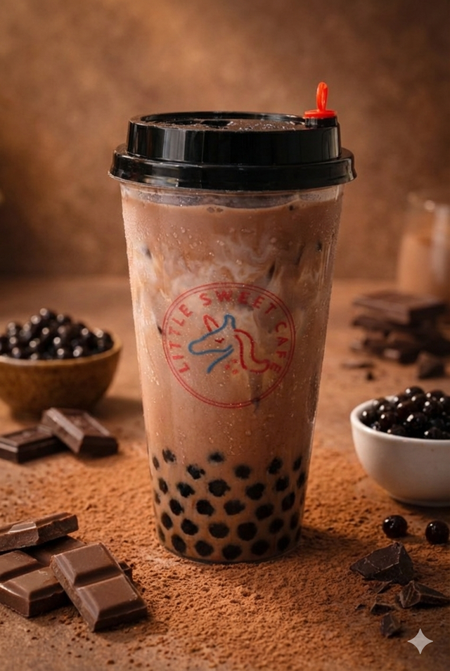

# Chocolate Bubble Milk Tea

{ .lsc-photo width="320" }

**Purpose:** Make the Chocolate Bubble Milk Tea the same way every time. 
**Who does it:** Drinks station staff 
**When:** Every Chocolate Bubble Milk Tea order 
**Time needed:** TODO(owner) 
**Equipment and supplies:** cup, pearl scoop, ice scoop, shaker (powder drinks), sealer 
**Last reviewed:** 2026-11-06

## Ingredients (1 cup)

- Cocoa powder: **1 tbsp**
- Coffee-mate: **1 spoon**
- Sugar syrup: **1.5 shots** (45 ml)
- Fresh milk: until the mixing cup reaches **500–600 ml**
- Pearls: **1.5 scoops**
- Ice: **1 scoop**, in the mixing cup

!!! danger "⚠️ Warning: allergens"
    - Fresh milk: **milk**.
    - Cocoa powder: check the label.
    - Coffee-mate: check the label (usually contains a **milk** protein).
    - Pearls: check the label.
    - If a customer asks about allergens and you are not sure, **do not guess**. Ask the shift lead.

## Steps

1. Make the base: follow [Powder base](index.md#powder-base) with **1 tbsp** of cocoa powder (ice and milk go in the mixing cup).
2. Add **1.5 scoops** of pearls to the cup.
3. Pour the chocolate base (with the ice) into the cup.
4. Add any **drink toppings** the customer ordered. See [Drink toppings](index.md#drink-toppings).
5. Close the cup (seal or lid). See [Finish and seal](index.md#finish-and-seal).

## Before serving

- [ ] Right drink and right toppings for the order
- [ ] Cup is filled to the right level
- [ ] Cup is closed (seal or lid)
