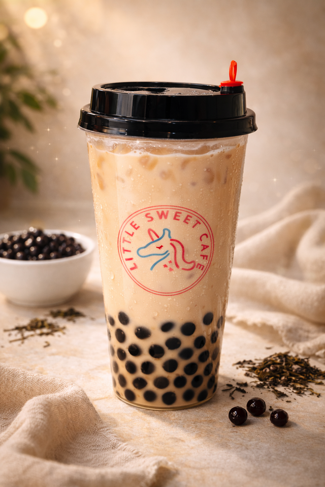

# Classic Bubble Milk Tea

{ .lsc-photo width="320" }

**Purpose:** Make the Classic Bubble Milk Tea the same way every time. 
**Who does it:** Drinks station staff 
**When:** Every Classic Bubble Milk Tea order 
**Time needed:** TODO(owner) 
**Equipment and supplies:** cup, pearl scoop, ice scoop, shaker (powder drinks), sealer 
**Last reviewed:** 2026-11-06

## Ingredients (1 cup)

- Pearls: **1.5 scoops**
- Ice: **1 scoop**
- Milk tea (made in advance): to almost full

!!! danger "⚠️ Warning: allergens"
    - Milk tea (made in advance): TODO(owner): confirm. Treat it as containing **milk** until confirmed.
    - Pearls: check the label.
    - If a customer asks about allergens and you are not sure, **do not guess**. Ask the shift lead.

## Steps

1. Add **1.5 scoops** of pearls to the cup.
2. Add **1 scoop** of ice.
3. Pour milk tea until the cup is **almost full**.
4. Add any **drink toppings** the customer ordered. See [Drink toppings](index.md#drink-toppings).
5. Close the cup (seal or lid). See [Finish and seal](index.md#finish-and-seal).

## Before serving

- [ ] Right drink and right toppings for the order
- [ ] Cup is filled to the right level
- [ ] Cup is closed (seal or lid)
