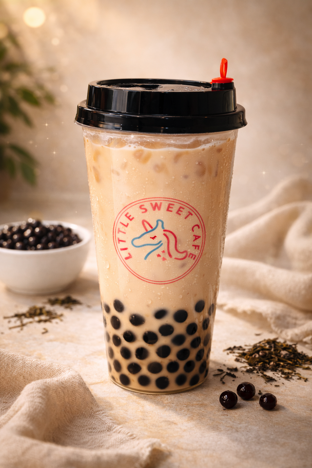
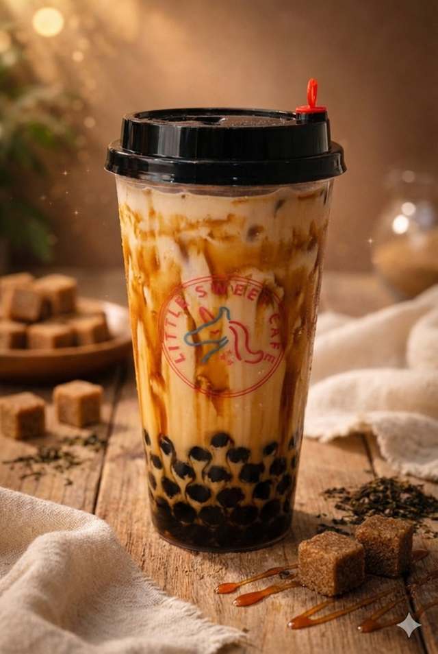
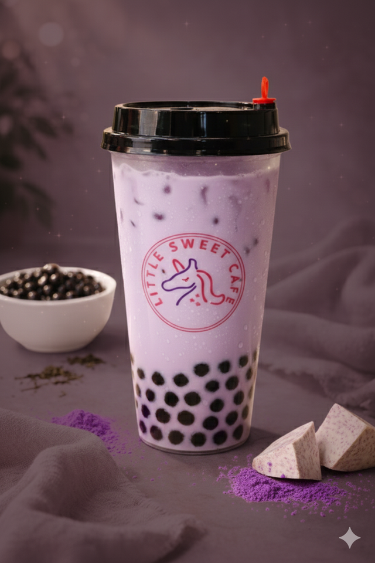
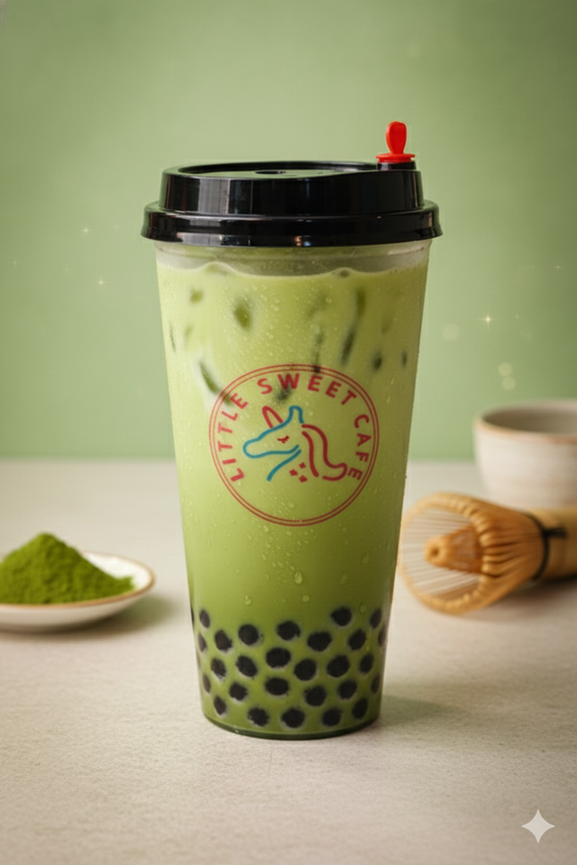
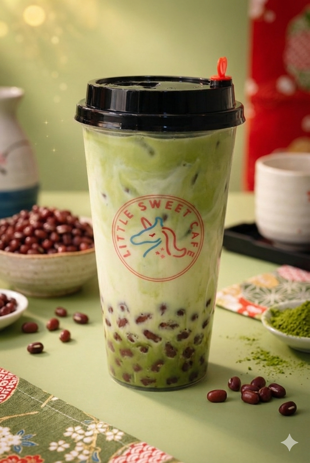
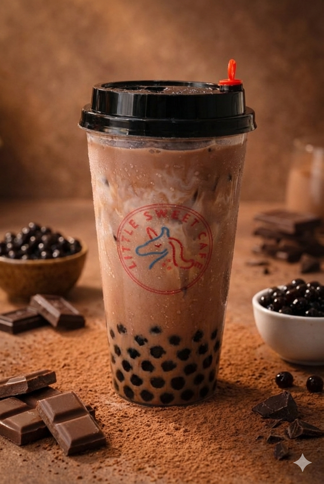
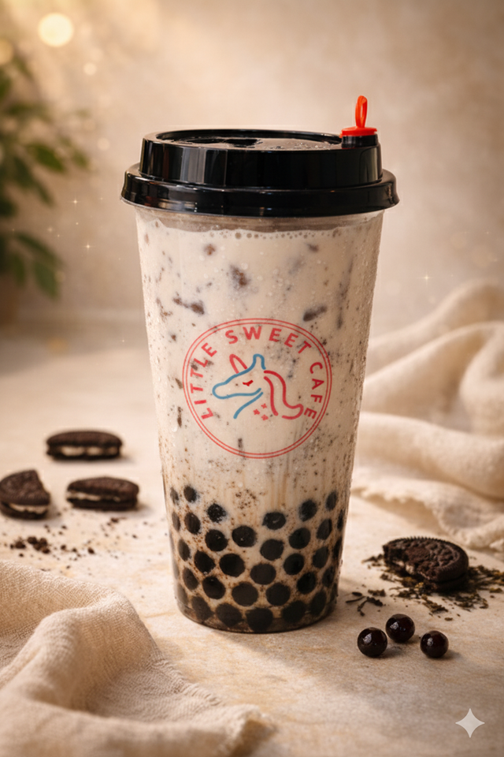

# Milk Tea

This page has the method shared by every milk tea: the cup build, the powder base, drink toppings and sealing. Each drink has its own card.

## Choose a drink

-   

    [**Classic Bubble Milk Tea**](classic-bubble-milk-tea.md)

-   

    [**Brown Sugar Bubble Tea**](brown-sugar-bubble-tea.md)

-   

    [**Taro Bubble Tea**](taro-bubble-tea.md)

-   

    [**Matcha Bubble Tea**](matcha-bubble-tea.md)

-   

    [**Matcha Red Bean**](matcha-red-bean.md)

-   

    [**Chocolate Bubble Milk Tea**](chocolate-bubble-milk-tea.md)

-   

    [**Oreo Cream Cheese Bubble Milk Tea**](oreo-cream-cheese-bubble-milk-tea.md)

-   

    [**Super Oreo Bubble Milk Tea**](super-oreo-bubble-milk-tea.md)

-   [No photo yet](little-sweet-coffee.md)

    [**Little Sweet Coffee**](little-sweet-coffee.md)

-   [No photo yet](matcha-strawberry.md)

    [**Matcha Strawberry**](matcha-strawberry.md)

**Purpose:** Make every milk tea the same way. 
**Who does it:** Drinks station staff 
**When:** Every milk tea order 
**Time needed:** TODO(owner) 
**Equipment and supplies:** cups, pearl scoop, ice scoop, shaker, teaspoon, tablespoon, sealer 
**Last reviewed:** 2026-11-06

The milk tea, the pearls and the coffee are made in advance. Their recipes are not in these docs.

## The basic cup

Most milk teas are built like this:

1. Add **1.5 scoops** of pearls to the cup. Use the pearl scoop.
2. Add **1 scoop** of ice. Use the ice scoop.
3. Pour the drink until the cup is **almost full**.

TODO(owner): cup size (ml).

## Powder base

Taro, Matcha, Matcha Red Bean, Chocolate and Super Oreo use a powder base made with **fresh milk**:

1. Put the powder in the shaker:
    - **Taro:** 2 full spoons of taro powder
    - **Matcha:** 6 g of matcha powder (1.5 spoons)
    - **Chocolate:** 1 tbsp cocoa powder
2. Add **1 spoon** of Coffee-mate.
3. Add **1.5 shots** (45 ml) of sugar syrup.
4. Add fresh milk. TODO(owner): how much (ml).
5. Shake well until the powder is fully mixed in.

TODO(owner): is the "spoon" for taro powder and Coffee-mate a teaspoon or a tablespoon?

## Which drink uses what

- **Milk tea (made in advance):** Classic, Oreo Cream Cheese
- **Fresh milk + brown sugar syrup:** Brown Sugar
- **Powder base:** Taro, Matcha, Matcha Red Bean, Chocolate, Super Oreo, Matcha Strawberry
- **Coffee (made in advance):** Little Sweet Coffee

## Drink toppings

Customers can add drink toppings. These are the online options:

- Black Pearl
- White Pearl
- Taro Smash
- Coconut Jelly
- Rainbow Jelly
- Red Bean

TODO(owner): how much of each extra topping (for example 1.5 scoops, the same as the pearls).

Check Square for topping prices. Don't quote prices from this page.

## Finish and seal

TODO(owner): which drinks are sealed with the sealer, and which get a lid (for example, drinks with whipped cream, soufflé cream or wafers on top)? Also add the straw and the takeaway/Uber Eats packing.

