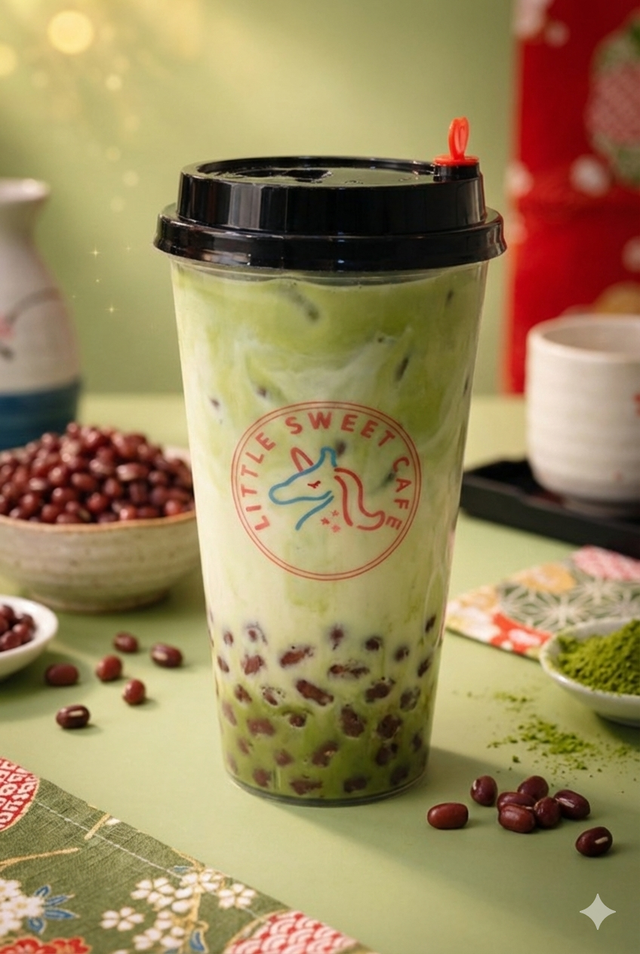

# Matcha Red Bean

{ width="320" }

Make it look like this photo.

- **Purpose:** Make the Matcha Red Bean the same way every time.
- **Who does it:** Drinks station staff
- **When:** Every Matcha Red Bean order
- **Time needed:** TODO(owner)
- **Equipment and supplies:** cup, pearl scoop, ice scoop, shaker (powder drinks), sealer
- **Last reviewed:** 2026-11-06

## Ingredients (1 cup)

- Matcha powder: **6 g** (1.5 spoons)
- Coffee-mate: **1 spoon**
- Sugar syrup: **1.5 shots** (45 ml)
- Fresh milk: TODO(owner) ml
- Red bean: **1.5 scoops** (instead of pearls)
- Ice: **1 scoop**

!!! warning "⚠️ Warning: allergens"
    - Fresh milk: **milk**.
    - Matcha powder: check the label.
    - Coffee-mate: check the label (usually contains a **milk** protein).
    - Red bean: check the label.
    - If a customer asks about allergens and you are not sure, **do not guess**. Ask the shift lead.

## Steps

1. Make the base: follow [Powder base](index.md#powder-base) with **6 g** of matcha powder.
2. Add **1.5 scoops** of red bean to the cup. **No pearls.**
3. Add **1 scoop** of ice.
4. Pour the matcha base into the cup.
5. Add any **drink toppings** the customer ordered. See [Drink toppings](index.md#drink-toppings).
6. Close the cup (seal or lid). See [Finish and seal](index.md#finish-and-seal).

## Before serving

- [ ] Right drink and right toppings for the order
- [ ] Cup is filled to the right level
- [ ] Cup is closed (seal or lid)
