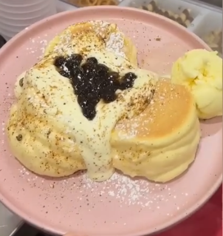

# Brown Sugar with Pearls Soufflé Pancake

{ width="320" }

Make it look like this photo.

- **Purpose:** Make the Brown Sugar with Pearls Soufflé Pancake the same way every time.
- **Who does it:** Soufflé station staff
- **When:** Every Brown Sugar with Pearls Soufflé Pancake order
- **Time needed:** about 3 min whipping, 9 min cooking, plus plating
- **Equipment and supplies:** egg mixer, soufflé machine, piping bag, water spray bottle, plate (dine-in), large box or round box (takeaway, Uber Eats)
- **Last reviewed:** 2026-11-06

## Ingredients (1 serve)

- Soufflé pancakes: **3** (Uber Eats: **2**)
- Soufflé cream (made in advance): **3–4 tbsp**
- Vanilla ice cream: **1 scoop** (not for Uber Eats)
- Black pearls: **1.5 tbsp**
- Black sugar: sprinkle on the soufflé cream
- Black sugar sauce: drizzle
- Icing sugar: dust over the top

!!! warning "⚠️ Warning: allergens"
    - Pancakes: **egg, wheat (gluten)**. Corn flour: check the pack, because some Australian "cornflour" is made from wheat.
    - Soufflé cream: TODO(owner): confirm. Treat it as containing **milk and egg** until confirmed.
    - Ice cream: **milk**. TODO(owner): brand, to check other allergens on the label.
    - Black pearls and black sugar sauce: check the labels.
    - If a customer asks about allergens and you are not sure, **do not guess**. Ask the shift lead.

## Steps

1. Make and cook the pancakes. Follow [Make and cook](index.md#make-and-cook).
2. **Takeaway or Uber Eats?** Follow [Takeaway and Uber Eats](index.md#takeaway-and-uber-eats) for the packing, and use the topping steps below.
3. Put **3 pancakes** on a plate, as in the photo.
4. Spoon **3–4 tbsp soufflé cream** over the pancakes.
5. Put **1.5 tbsp black pearls** on top of the soufflé cream.
6. Sprinkle **black sugar** over the soufflé cream.
7. Drizzle **black sugar sauce** over the top.
8. Dust **icing sugar** over the top.
9. Add **1 scoop** of vanilla ice cream on the side of the plate.
10. Check that it looks like the photo, then serve.

## Before serving

- [ ] Pancakes are tall and cooked through (4.5 min each side)
- [ ] 3–4 tbsp soufflé cream
- [ ] All toppings are on, as in the photo
- [ ] Icing sugar on top
- [ ] 1 scoop of vanilla ice cream (separate cup for takeaway, none for Uber Eats)
