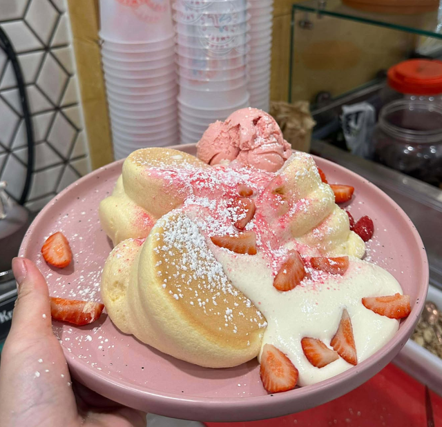
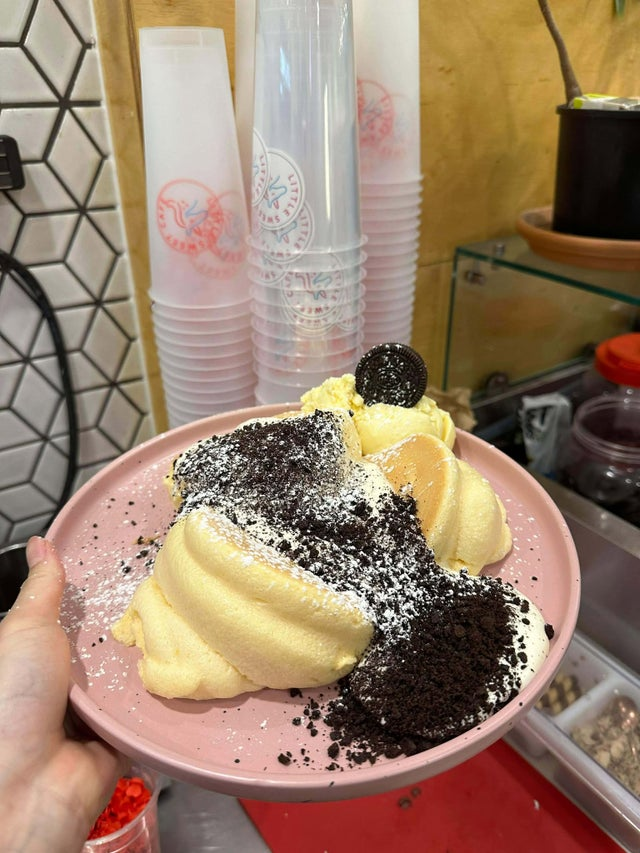
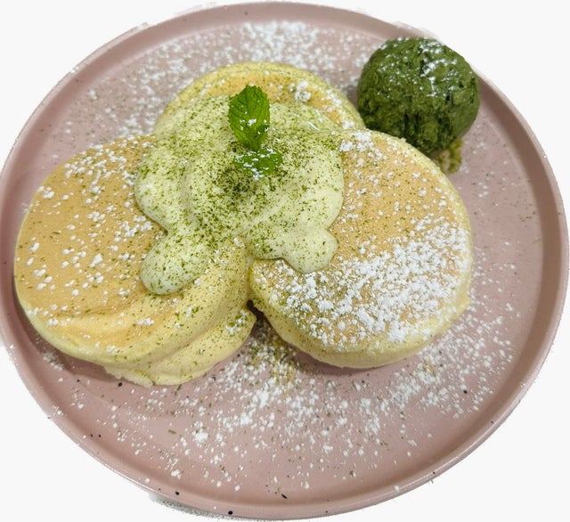
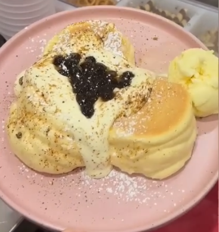
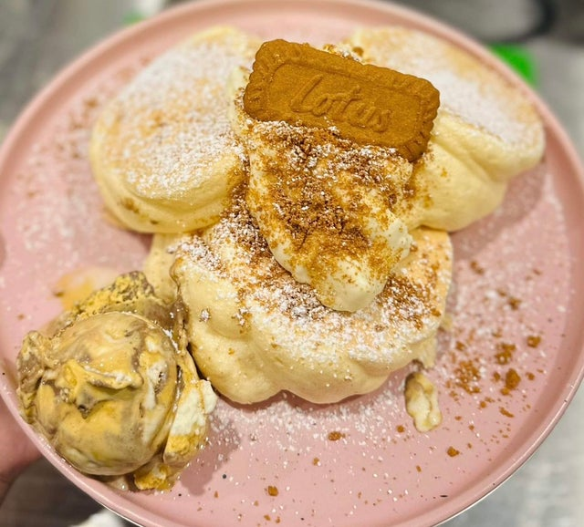

# Soufflé Pancakes

This page has the method shared by every soufflé pancake: making the batter, cooking, and packing for takeaway and Uber Eats. Each item has its own card with its toppings.

## Choose a soufflé pancake

-   

    [**Strawberry Soufflé Pancake**](strawberry-souffle-pancake.md)

-   

    [**Oreo Soufflé Pancake**](oreo-souffle-pancake.md)

-   

    [**Matcha Soufflé Pancake**](matcha-souffle-pancake.md)

-   

    [**Brown Sugar with Pearls Soufflé Pancake**](brown-sugar-with-pearls-souffle-pancake.md)

-   

    [**Biscoff Soufflé Pancake**](biscoff-souffle-pancake.md)

The Pork Floss Soufflé Pancake is no longer sold.

**Purpose:** Make, cook and serve every soufflé pancake the same way. 
**Who does it:** Soufflé station staff 
**When:** Every soufflé pancake order 
**Time needed:** about 3 min whipping, 9 min cooking, plus plating 
**Equipment and supplies:** egg mixer, soufflé machine (griddle with lid), mixing bowl, hand whisk, piping bag, water spray bottle, tablespoon and teaspoon 
**Last reviewed:** 2026-11-06

## Ingredients (1 serve = 3 pancakes)

**Meringue:**

- Egg whites: **2**, cold, straight from the fridge
- Sugar: **1.5 tbsp**
- Corn flour: **½ tsp**
- Vanilla extract: **a few drops**
- Lemon juice: **a few drops**

**Yolk mix:**

- Whole egg: **1**
- Egg yolk: **1**
- Cake flour: **1.5 tbsp**

The soufflé cream is made in advance. Its recipe is not in these docs.

!!! danger "⚠️ Warning: allergens"
    The pancakes contain **egg** and **wheat (gluten)**. Check the corn flour pack, because some Australian "cornflour" is made from wheat.

## Make and cook

**Start the meringue first.** It takes 2–3 minutes to whip.

!!! warning "⚠️ Warning: no yolk in the whites"
    Separate the eggs carefully. **Even a tiny bit of yolk** stops the whites from whipping. If yolk gets in, start again with new eggs.

1. Separate **2 egg whites** into the mixer bowl. Use cold eggs, straight from the fridge.
2. Add **1.5 tbsp sugar**. Don't skip the sugar, because without it the whites won't whip.
3. Add **½ tsp corn flour**, a few drops of **vanilla extract** and a few drops of **lemon juice**.
4. Turn on the mixer.
5. Turn on the soufflé machine and heat it to **160 °C**.
6. Make the yolk mix: put **1 whole egg**, **1 egg yolk** and **1.5 tbsp cake flour** in a bowl.
7. Whisk the yolk mix by hand until the flour is fully mixed in, with no lumps.
8. Whip the meringue until it makes a **2–3 cm peak** on the tip of the whisk.
9. Pour the meringue into the yolk mix.
10. Stir until it is evenly mixed.
11. Pour the mixture into a **piping bag**.
12. Pipe **3 pancakes** onto the griddle. The piping bag shapes them, so no ring is needed. The griddle holds **up to 6** (2 serves).
13. **Spray water** on the griddle surface.
14. Close the lid and cook for **4.5 min**.
15. Flip the pancakes.
16. **Spray water** on the griddle surface again.
17. Close the lid and cook for **4.5 min**.
18. Take the pancakes out and follow the item's card for the toppings.

TODO(owner): confirm the topping order on the item cards (pancakes → soufflé cream → toppings → icing sugar → ice cream).

## Dine-in

Put **3 pancakes** on a plate, then follow the item's card.

## Takeaway and Uber Eats

**Takeaway at the shop:**

1. Put **3 pancakes** in a **large box**.
2. Add the soufflé cream and toppings on top, the same as dine-in.
3. Put the ice cream in a **separate cup**.
4. Put the box and the cup in a **takeaway bag**.

**Uber Eats:**

1. Put **2 pancakes** in a **round box**.
2. Add the soufflé cream and toppings on top, the same as dine-in.
3. **No ice cream** for Uber Eats.

## Extras

Customers can add extra ice cream (1 scoop, any flavour) or extra toppings to a soufflé pancake. These are the same extras as the waffles. An extra is the **same amount** as on a normal item. See [Bubble Waffles: Extras](../waffles/index.md#extras).

