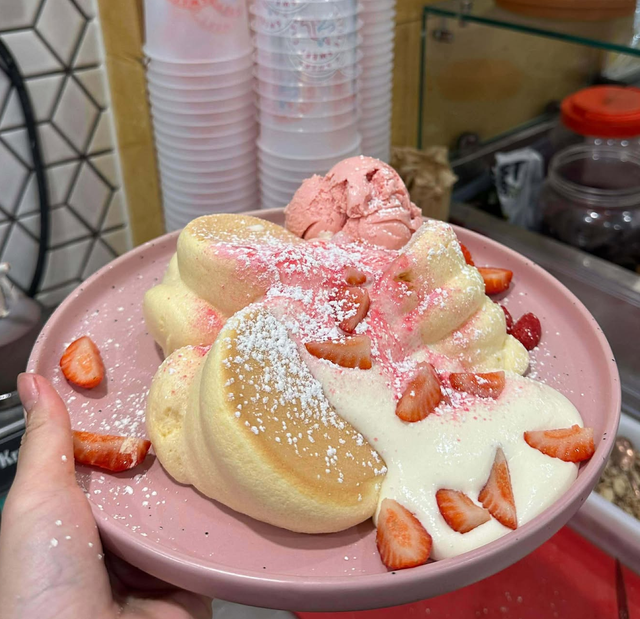

# Strawberry Soufflé Pancake

{ .lsc-photo width="320" }

**Purpose:** Make the Strawberry Soufflé Pancake the same way every time. 
**Who does it:** Soufflé station staff 
**When:** Every Strawberry Soufflé Pancake order 
**Time needed:** about 3 min whipping, 9 min cooking, plus plating 
**Equipment and supplies:** egg mixer, soufflé machine, piping bag, water spray bottle, plate (dine-in), large box or round box (takeaway, Uber Eats) 
**Last reviewed:** 2026-11-06

## Ingredients (1 serve)

- Soufflé pancakes: **3** (Uber Eats: **2**)
- Soufflé cream (made in advance): **3–4 tbsp**
- Strawberry ice cream: **1 scoop** (not for Uber Eats)
- Strawberries: **4**, each cut into 4
- Strawberry powder: sprinkle on the soufflé cream
- Icing sugar: dust over the top

!!! danger "⚠️ Warning: allergens"
    - Pancakes: **egg, wheat (gluten)**. Corn flour: check the pack, because some Australian "cornflour" is made from wheat.
    - Soufflé cream: TODO(owner): confirm. Treat it as containing **milk and egg** until confirmed.
    - Ice cream: **milk**. TODO(owner): brand, to check other allergens on the label.
    - Strawberry powder: check the label.
    - If a customer asks about allergens and you are not sure, **do not guess**. Ask the shift lead.

## Steps

1. Make and cook the pancakes. Follow [Make and cook](index.md#make-and-cook).
2. **Takeaway or Uber Eats?** Follow [Takeaway and Uber Eats](index.md#takeaway-and-uber-eats) for the packing, and use the topping steps below.
3. Put **3 pancakes** on a plate, as in the photo.
4. Spoon **3–4 tbsp soufflé cream** over the pancakes.
5. Cut **4 strawberries** into 4 pieces each. Arrange them as in the photo.
6. Sprinkle **strawberry powder** over the soufflé cream.
7. Dust **icing sugar** over the top.
8. Add **1 scoop** of strawberry ice cream on the side of the plate.
9. Check that it looks like the photo, then serve.

## Before serving

- [ ] Pancakes are tall and cooked through (4.5 min each side)
- [ ] 3–4 tbsp soufflé cream
- [ ] All toppings are on, as in the photo
- [ ] Icing sugar on top
- [ ] 1 scoop of strawberry ice cream (separate cup for takeaway, none for Uber Eats)
