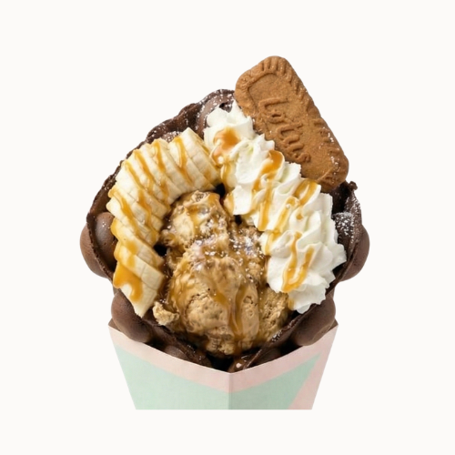

# Caramel Banana Waffle

{ width="320" }

Make it look like this photo.

- **Purpose:** Make the Caramel Banana Waffle the same way every time.
- **Who does it:** Waffle station staff
- **When:** Every Caramel Banana Waffle order
- **Time needed:** 3 min in the iron, plus fan time and topping
- **Equipment and supplies:** bubble waffle iron, cone mould, fan, ice cream scoop, waffle cone holder (dine-in), $0.50 container (takeaway), paper bag (takeaway)
- **Last reviewed:** 2026-11-06

## Ingredients (1 waffle)

- Chocolate batter (made in advance): fill **half the iron**
- Caramel ice cream: **1 scoop**
- Whipped cream: enough to make the waffle **look full**
- Banana: **1/3 to 1/2 of a banana**, depending on its size
- Biscuit: **as in the photo**
- Caramel sauce: **zig-zag drizzle** over the top

!!! warning "⚠️ Warning: allergens"
    - Batter: TODO(owner): confirm. Treat it as containing **egg, milk and wheat (gluten)** until confirmed.
    - Ice cream: **milk**. TODO(owner): brand, to check other allergens on the label.
    - Whipped cream: **milk**.
    - Biscuit: **wheat (gluten)**, and check the pack. TODO(owner): biscuit brand.
    - Caramel sauce: may contain **milk**. Check the bottle label.
    - If a customer asks about allergens and you are not sure, **do not guess**. Ask the shift lead.

## Steps

1. Cook and shape a waffle with **chocolate batter**. Follow [Cook and shape](index.md#cook-and-shape): 150 °C, fill half the iron, 3 min, cone mould, fan until crisp.
2. **Takeaway?** Follow [Takeaway](index.md#takeaway) instead of the steps below.
3. Stand the waffle in the waffle cone holder.
4. Add **1 scoop** of caramel ice cream.
5. Add whipped cream until the waffle looks full.
6. Slice **1/3 to 1/2 of a banana** (depending on its size) and add it.
7. Add the biscuit, **as in the photo**.
8. Drizzle caramel sauce over the top in a zig-zag.
9. Check that it looks like the photo, then serve.

## Before serving

- [ ] Waffle is crisp, holds the cone shape and has stopped steaming
- [ ] 1 scoop of caramel ice cream
- [ ] Whipped cream looks full
- [ ] All toppings are on, as in the photo
- [ ] Caramel sauce zig-zag on top
- [ ] Takeaway: ice cream and toppings are in the $0.50 container, separate from the waffle
