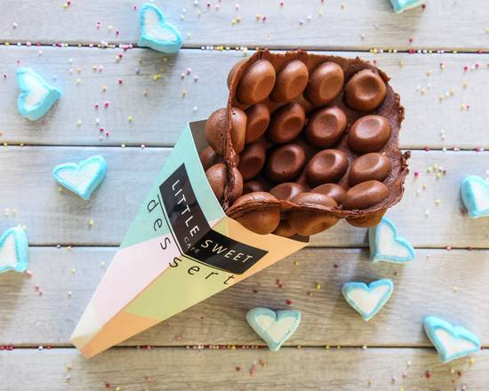

# Chocolate Waffle

{ .lsc-photo width="320" }

**Purpose:** Make the Chocolate Waffle the same way every time. 
**Who does it:** Waffle station staff 
**When:** Every Chocolate Waffle order 
**Time needed:** 3 min in the iron, plus fan time 
**Equipment and supplies:** bubble waffle iron, cone mould, fan, paper bag (takeaway) 
**Last reviewed:** 2026-11-06

## Ingredients (1 waffle)

- Chocolate batter (made in advance): fill **half the iron**

!!! danger "⚠️ Warning: allergens"
    - Batter: TODO(owner): confirm. Treat it as containing **egg, milk and wheat (gluten)** until confirmed.
    - If a customer asks about allergens and you are not sure, **do not guess**. Ask the shift lead.

## Steps

1. Cook and shape a waffle with **chocolate batter**. Follow [Cook and shape](index.md#cook-and-shape): 150 °C, fill half the iron, 3 min, cone mould, fan until crisp.
2. Serve the waffle with no ice cream or toppings.
3. Takeaway: wrap the waffle in a paper bag, then put it in a recycle bag.

## Before serving

- [ ] Waffle is crisp, holds the cone shape and has stopped steaming
