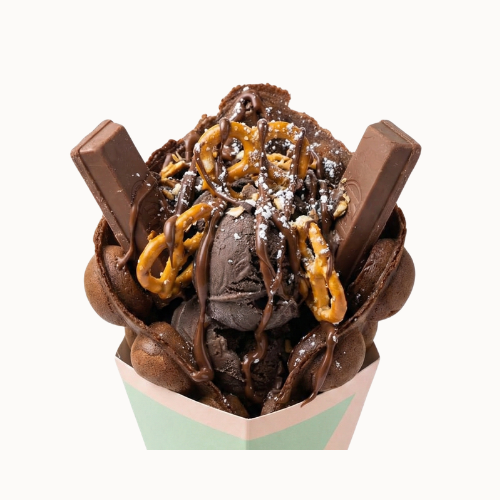

# Devil Waffle

{ width="320" }

Make it look like this photo.

- **Purpose:** Make the Devil Waffle the same way every time.
- **Who does it:** Waffle station staff
- **When:** Every Devil Waffle order
- **Time needed:** 3 min in the iron, plus fan time and topping
- **Equipment and supplies:** bubble waffle iron, cone mould, fan, ice cream scoop, waffle cone holder (dine-in), $0.50 container (takeaway), paper bag (takeaway)
- **Last reviewed:** 2026-11-06

## Ingredients (1 waffle)

- Chocolate batter (made in advance): fill **half the iron**
- Chocolate ice cream: **1 scoop**
- Tim Tams: **2**
- Pretzels: **as in the photo**
- Almond flakes: **as in the photo**
- Icing sugar: **dust over the top**
- Nutella: **zig-zag drizzle** over the top

!!! warning "⚠️ Warning: allergens"
    - Batter: TODO(owner): confirm. Treat it as containing **egg, milk and wheat (gluten)** until confirmed.
    - Ice cream: **milk**. TODO(owner): brand, to check other allergens on the label.
    - Tim Tam: **wheat (gluten), milk, soy**.
    - Pretzels: **wheat (gluten)**. Check the pack.
    - Almond flakes: **almond (tree nut)**.
    - Nutella: **milk, hazelnut (tree nut), soy**.
    - If a customer asks about allergens and you are not sure, **do not guess**. Ask the shift lead.

## Steps

1. Cook and shape a waffle with **chocolate batter**. Follow [Cook and shape](index.md#cook-and-shape): 150 °C, fill half the iron, 3 min, cone mould, fan until crisp.
2. **Takeaway?** Follow [Takeaway](index.md#takeaway) instead of the steps below.
3. Stand the waffle in the waffle cone holder.
4. Add **1 scoop** of chocolate ice cream.
5. Add **2 Tim Tams**.
6. Add pretzels, **as in the photo**.
7. Sprinkle almond flakes, **as in the photo**.
8. Drizzle Nutella over the top in a zig-zag.
9. Dust icing sugar over the top.
10. Check that it looks like the photo, then serve.

## Before serving

- [ ] Waffle is crisp, holds the cone shape and has stopped steaming
- [ ] 1 scoop of chocolate ice cream
- [ ] All toppings are on, as in the photo
- [ ] Nutella zig-zag on top
- [ ] Takeaway: ice cream and toppings are in the $0.50 container, separate from the waffle
