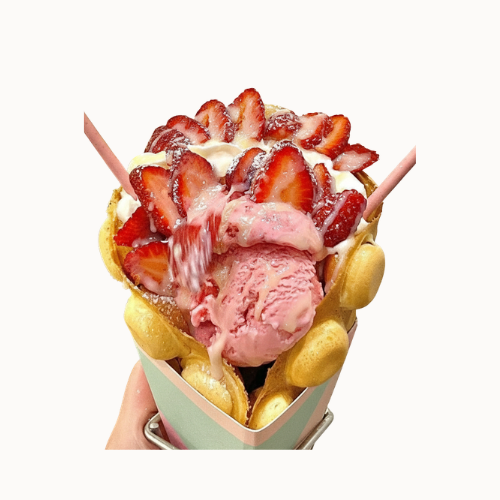

# White Strawberry Waffle

{ .lsc-photo width="320" }

**Purpose:** Make the White Strawberry Waffle the same way every time. 
**Who does it:** Waffle station staff 
**When:** Every White Strawberry Waffle order 
**Time needed:** 3 min in the iron, plus fan time and topping 
**Equipment and supplies:** bubble waffle iron, cone mould, fan, ice cream scoop, waffle cone holder (dine-in), $0.50 container (takeaway), paper bag (takeaway) 
**Last reviewed:** 2026-11-06

## Ingredients (1 waffle)

- Original batter (made in advance): fill **half the iron**
- Strawberry ice cream: **1 scoop**
- Whipped cream: enough to make the waffle **look full**
- Wafer sticks: **2**
- Strawberries: **4 medium**, sliced
- Condensed milk: **zig-zag drizzle** over the top

!!! danger "⚠️ Warning: allergens"
    - Batter: TODO(owner): confirm. Treat it as containing **egg, milk and wheat (gluten)** until confirmed.
    - Ice cream: **milk**. TODO(owner): brand, to check other allergens on the label.
    - Whipped cream: **milk**.
    - Wafer sticks: **wheat (gluten)**. Check the pack for milk, soy and nuts.
    - Condensed milk: **milk**.
    - If a customer asks about allergens and you are not sure, **do not guess**. Ask the shift lead.

## Steps

1. Cook and shape a waffle with **original batter**. Follow [Cook and shape](index.md#cook-and-shape): 150 °C, fill half the iron, 3 min, cone mould, fan until crisp.
2. **Takeaway?** Follow [Takeaway](index.md#takeaway) instead of the steps below.
3. Stand the waffle in the waffle cone holder.
4. Add **1 scoop** of strawberry ice cream.
5. Add whipped cream until the waffle looks full.
6. Add **2 wafer sticks**.
7. Slice **4 medium strawberries** and add them.
8. Drizzle condensed milk over the top in a zig-zag.
9. Check that it looks like the photo, then serve.

## Before serving

- [ ] Waffle is crisp, holds the cone shape and has stopped steaming
- [ ] 1 scoop of strawberry ice cream
- [ ] Whipped cream looks full
- [ ] All toppings are on, as in the photo
- [ ] Condensed milk zig-zag on top
- [ ] Takeaway: ice cream and toppings are in the $0.50 container, separate from the waffle
