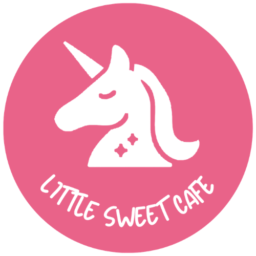
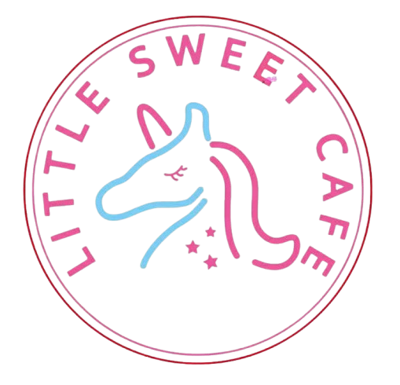

# Style guide

How the Little Sweet Cafe docs look and how to write them. The docs site matches the customer website, [littlesweetcafe.com.au](https://littlesweetcafe.com.au/), so staff see the same brand everywhere.

## Brand

### Logo

| Logo | Use it for |
|---|---|
| { .lsc-logo width="72" } | **Solid logo.** White unicorn on a pink circle. Used in the site header. |
| { .lsc-logo width="72" } | **Outline logo.** Pink and blue neon-style unicorn. Used on the homepage and as the browser icon. |

- Use the logo files in `site/assets/images/`. Don't redraw, recolour, stretch or crop them.
- These files are copies of the logos on the Square Online site. If the logo changes there, replace the files here too (keep the same filenames).

### Colours

| Colour | Hex | Use it for |
|---|---|---|
| <span style="display:inline-block;width:1.2em;height:1.2em;border-radius:4px;background:#e96389;vertical-align:middle"></span> Brand pink | `#e96389` | Header, H1 titles, buttons, links |
| <span style="display:inline-block;width:1.2em;height:1.2em;border-radius:4px;background:#b2858e;vertical-align:middle"></span> Soft red | `#b2858e` | Muted text, unticked checkboxes |
| <span style="display:inline-block;width:1.2em;height:1.2em;border-radius:4px;background:#bb8650;vertical-align:middle"></span> Caramel | `#bb8650` | Occasional highlight only |
| <span style="display:inline-block;width:1.2em;height:1.2em;border-radius:4px;background:#ffffff;border:1px solid #ccc;vertical-align:middle"></span> White | `#ffffff` | Text on pink, page background |

These are the same colours set in the Square Online theme. All colours are defined once in `site/stylesheets/extra.css`, so don't add colours inside individual docs.

### Fonts

- **Headings:** Quicksand, bold. This matches the Square site.
- **Body text:** DM Sans. The Square site uses Larsseit, which is a paid font, so the docs use DM Sans as a free font that looks similar.

### Shapes

These match the Square theme: buttons have 8 px rounded corners, boxes and tables 4 px, photos 16 px. The theme applies them automatically.

### Voice

- **Customer copy** (website, blog, menu) is warm, playful and a little indulgent. For example: "Your daily dose of happiness".
- **Staff docs** are clear and calm. Short sentences. No jokes in safety steps.
- Write in Australian English: colour, flavour, favourite, organise.
- Always write **soufflé pancakes** with the accent.

## Writing a staff doc

Many readers are casual staff, and English may be their second language. Write for someone holding the page at the station during a rush.

### Rules

1. **One action per step.** Use numbered steps and start each step with a verb: "Wipe…", "Check…", "Set the timer to…".
2. **Use exact numbers.** Write "Cook 2 min 30 s at 180 °C", not "cook until done".
3. **Put warnings before the step** they apply to, never after.
4. **Keep it to one or two A4 pages.** If a doc is longer, split it.
5. **End with a checklist** (SOPs and maintenance docs) that staff can print and tick.
6. **Don't guess.** If you don't know a model number, setting or supplier, write `TODO(owner): …` and ask the owner.
7. **Keep it public-safe.** This site is public. Never include alarm codes, safe codes, passwords, supplier prices or staff personal details.

### Food safety rules to follow

- Cold food is kept at **5 °C or below**. Hot food is kept at **60 °C or above**.
- Use the **2-hour/4-hour rule** for potentially hazardous food.
- The rules come from FSANZ Standard 3.2.2A and Queensland food safety law.
- Allergens on our menu include **milk, egg, gluten/wheat, soy, peanut/tree nuts** and **fish**. Pork floss can contain fish or soy, so check the label.

### Files and folders

| Type of doc | Folder | Example filename |
|---|---|---|
| Training | `training/` | `training/waffle-station.md` |
| Procedure (SOP) | `procedures/` | `procedures/closing-checklist.md` |
| Maintenance | `maintenance/` | `maintenance/ice-machine.md` |
| Recipe card | `recipes/` | `recipes/strawberry-souffle-pancake.md` |
| Photos and diagrams | `assets/` | `assets/recipes/strawberry-souffle-pancake.jpg` |

- Filenames are lower case, with words joined by hyphens (`-`). No spaces.
- The first line of each doc is its `# Title`. The title becomes the page name in the menu.
- New folders appear in the menu automatically.

## Components

These are the building blocks to use in docs. Copy the code under each example.

### Header block

Every doc starts with this block, straight after the title.

<div class="lsc-meta" markdown>
**Purpose:** Close the shop safely and leave it ready for the next shift.<br>
**Who:** Closing staff (2 people)<br>
**When:** Every night after the last customer, from 10:30 pm<br>
**Time needed:** 45 min<br>
**Equipment/supplies:** Sanitiser, blue cloths, mop and bucket<br>
**Last reviewed:** 2026-11-06
</div>

```markdown
<div class="lsc-meta" markdown>
**Purpose:** …<br>
**Who:** …<br>
**When:** …<br>
**Time needed:** …<br>
**Equipment/supplies:** …<br>
**Last reviewed:** YYYY-MM-DD
</div>
```

### Warning

Use this for anything that can hurt someone or make a customer sick. Put it **before** the step.

!!! warning "⚠️ Warning"
    The waffle iron is over 200 °C. Use the handle only. Never touch the plates.

```markdown
!!! warning "⚠️ Warning"
    The waffle iron is over 200 °C. Use the handle only. Never touch the plates.
```

### Allergen note

!!! danger "Allergen"
    Biscoff spread contains **wheat and soy**. Tell the customer before they order.

```markdown
!!! danger "Allergen"
    Biscoff spread contains **wheat and soy**. Tell the customer before they order.
```

### Tip

!!! tip
    Pre-scoop ice cream into the freezer tray before the 8 pm rush.

```markdown
!!! tip
    Pre-scoop ice cream into the freezer tray before the 8 pm rush.
```

### Steps

1. Turn off the waffle iron at the wall.
2. Wait 20 min for it to cool.
3. Wipe the plates with a damp cloth.

```markdown
1. Turn off the waffle iron at the wall.
2. Wait 20 min for it to cool.
3. Wipe the plates with a damp cloth.
```

### Checklist

- [ ] Waffle irons off and cool
- [ ] Fridges at 5 °C or below (write the temperature in the log)
- [ ] Floors mopped

```markdown
- [ ] Waffle irons off and cool
- [ ] Fridges at 5 °C or below (write the temperature in the log)
- [ ] Floors mopped
```

### Photo

Save photos in `assets/` and always add alt text that describes the photo.

```markdown

```

## Doc template

Copy this into a new file to start a doc.

```markdown
# Closing checklist

<div class="lsc-meta" markdown>
**Purpose:** …<br>
**Who:** …<br>
**When:** …<br>
**Time needed:** …<br>
**Equipment/supplies:** …<br>
**Last reviewed:** YYYY-MM-DD
</div>

## Steps

!!! warning "⚠️ Warning"
    …

1. …
2. …

## Checklist

- [ ] …
- [ ] …
```

## Publishing

1. Add or edit the Markdown file in this repo.
2. Optional: preview it on your computer with `scripts/build-docs.sh serve`, then open <http://127.0.0.1:8000>.
3. Commit and push to `main`. The site updates in about 1 minute.
4. If the update fails, check the **Actions** tab on GitHub. A broken link is the most common cause.
