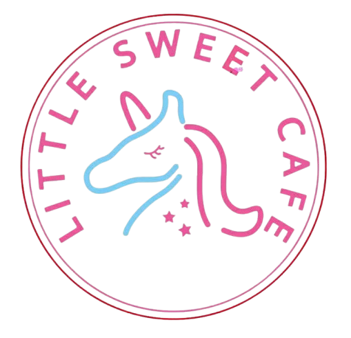

---
hide:
  - navigation
  - toc
---

{ .lsc-logo }

# Little Sweet Cafe Docs

Your daily dose of happiness starts with doing it right.

Staff guides for **Little Sweet Cafe**, Shop 10/2 Elkhorn Ave, Surfers Paradise. Use the tabs at the top or the search box to find what you need.

| Section | What's in it |
|---|---|
| Training | Onboarding and station training (drinks, waffles, soufflé pancakes, front counter) |
| Procedures | Opening, closing, cleaning, food safety, allergens, incidents |
| Maintenance | Cleaning and care for each piece of equipment |
| Recipes | Build cards for every menu item |
| Guide | How these docs look and how to write a new one |

Sections appear here as their docs are added.

!!! warning "Allergens"
    If a customer asks about allergens and you are not sure, **do not guess**. Check the allergen procedure or ask the shift lead.

[Writing a new doc? Read the style guide](guide/style-guide.md){ .md-button .md-button--primary }
[Customer website](https://littlesweetcafe.com.au/){ .md-button }
